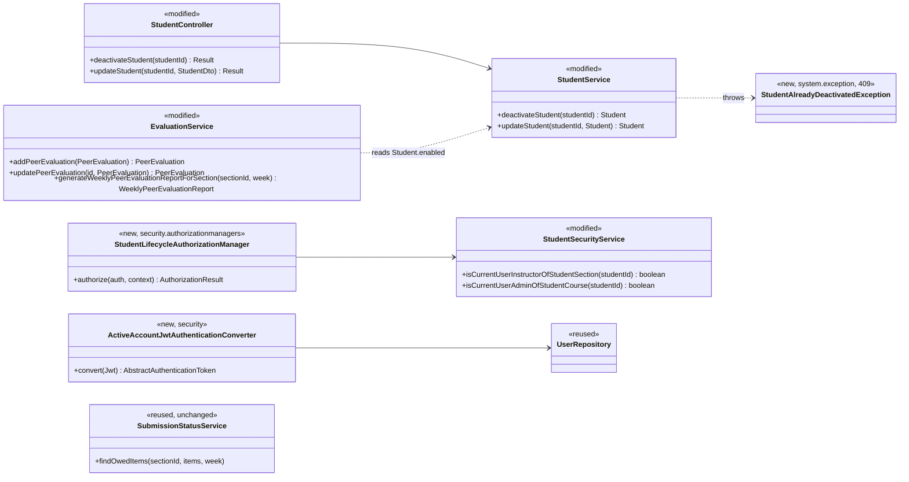
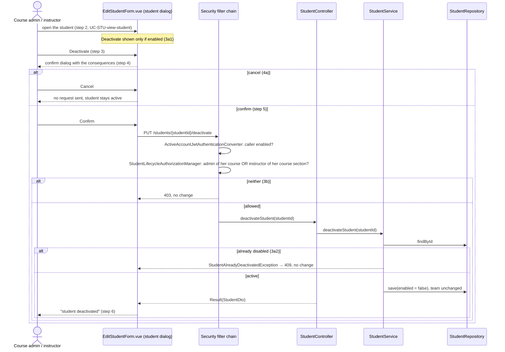
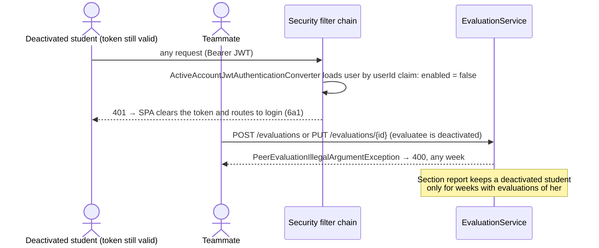

# Student (STU) Design

> Realizes: UC-STU-deactivate-student
> Depends on: FR-SEC-active-account, BR-student-lifecycle, BR-deactivated-student, BR-submission-owed, BR-section-scoped-access, BR-role-based-access
> See: [use cases](../requirements/use-cases.md#student), [business rules](../requirements/business-rules.md#weekly-activity-report-and-peer-evaluation), [SRS security requirements](../requirements/software-requirements-specification.md#security-and-authorization-requirements), [architectural-design.md](architectural-design.md#shared-foundation-components) (foundation component view, Crosscutting Concepts)
> Designed against `main` at `59f0267` (2026-11-06).

## Overview

This area covers the student account: finding, viewing, deleting, and (here) deactivating a student. It lives in the foundation's `student` slice of the REST API container. Deactivation does three things: it turns off the account's `enabled` flag through its own endpoint; the security layer denies a disabled account on every request; and the `evaluation` slice treats a disabled evaluatee per BR-deactivated-student. Reminders already skip a disabled student (`SubmissionStatusService`), so the notification slice needs no change.

Before this design, the only way to deactivate a student was the `enabled` switch on the generic `PUT /students/{studentId}`. That path had no warning or confirmation, refused course admins (contrary to BR-student-lifecycle), and left a logged-in student working until her 2-hour token expired (contrary to FR-SEC-active-account). The evaluation slice never checked whether the evaluatee was active.

## Components & classes

| Component | Reused / new | Where |
|---|---|---|
| Deactivate endpoint and service method | modified | [`StudentController`](../../backend/src/main/java/team/projectpulse/student/StudentController.java), [`StudentService`](../../backend/src/main/java/team/projectpulse/student/StudentService.java) |
| Who may deactivate | new manager + one new check | `security/authorizationmanagers/StudentLifecycleAuthorizationManager`, [`StudentSecurityService`](../../backend/src/main/java/team/projectpulse/student/StudentSecurityService.java) `isCurrentUserAdminOfStudentCourse` |
| Active-account check on every request | new | `security/ActiveAccountJwtAuthenticationConverter`, registered in [`SecurityConfiguration`](../../backend/src/main/java/team/projectpulse/security/SecurityConfiguration.java) |
| 3a rejection | new | `system/exception/StudentAlreadyDeactivatedException`, mapped in [`ExceptionHandlerAdvice`](../../backend/src/main/java/team/projectpulse/system/exception/ExceptionHandlerAdvice.java) |
| Evaluations of a deactivated student | modified | [`EvaluationService`](../../backend/src/main/java/team/projectpulse/evaluation/EvaluationService.java) |
| Reminders stop | reused, unchanged | [`SubmissionStatusService`](../../backend/src/main/java/team/projectpulse/notification/SubmissionStatusService.java) `findOwedItems` already filters `isEnabled()` |
| Generic PUT refuses deactivation | new | `system/exception/StudentIllegalArgumentException`, mapped to `INVALID_ARGUMENT` (400) like the other per-slice `*IllegalArgumentException`s |
| SPA | modified | [`apis/student`](../../frontend/src/apis/student/index.ts) `deactivateStudent`; [`EditStudentForm.vue`](../../frontend/src/pages/students/EditStudentForm.vue), the student dialog opened from [`Students.vue`](../../frontend/src/pages/students/Students.vue) (step 2), gets the Deactivate button and the confirm dialog; the list itself only shows status. [`SubmitTeamsEvaluations.vue`](../../frontend/src/pages/evaluations/SubmitTeamsEvaluations.vue) drops a teammate whose `enabled` (already on `StudentDto`) is false from the rows it creates **and** from the evaluations it re-submits on update, because it saves each row in one `Promise.all` and a single 400 would fail the whole save |

## Sequence

### UC-STU-deactivate-student: deactivate a student

### 6a and BR-deactivated-student: what deactivation changes elsewhere

## API contract

| Endpoint or job | Caller (who may) | Request | Success | Errors, by extension |
|---|---|---|---|---|
| `PUT /students/{studentId}/deactivate` (new) | The course admin who owns the student's course, or an instructor assigned to her course section (BR-student-lifecycle) | path `studentId`; no body | `Result` + `StudentDto`, `enabled` false, team unchanged | 3a → 409 "already deactivated", no change; 3b → 403; unknown id → 403 (fail-closed, as on the other student routes) |
| `PUT /students/{studentId}` (changed) | Unchanged | Unchanged | `enabled` false→true still honored (interim reactivation path) | `enabled` true→false → 400, no change: deactivation goes only through the endpoint above |
| `POST /evaluations` (changed) | Unchanged | Unchanged | Unchanged | Evaluatee deactivated → 400 |
| `PUT /evaluations/{evaluationId}` (changed) | Unchanged | Unchanged | Unchanged | Evaluatee deactivated → 400 |
| `GET /evaluations/sections/{sectionId}/week/{week}` (changed) | Unchanged | Unchanged | A deactivated student appears only for a week with evaluations of her | Unchanged |
| Every authenticated route (changed) | Unchanged | Unchanged | Unchanged | Caller's account disabled → 401 (6a, FR-SEC-active-account) |

## Key decisions

- **Re-check `enabled` on every request, in the JWT authentication converter.** It wraps the existing `jwtAuthenticationConverter()` bean, loads the user by the `userId` claim, and throws `DisabledException` if the account is disabled or gone. Spring's bearer-token failure path turns that into 401, which the SPA already treats as a logout. It applies to instructors too, as FR-SEC-active-account requires. *Rejected:* a shorter token lifetime, which narrows the window but never closes it; a revocation list, which is server state and blocks the multi-instance path; a token-version claim, which still needs the same lookup; a servlet filter after authentication, which would need its own 401 handling. *Cost:* one primary-key read per authenticated request, acceptable at this scale. **This must be the first commit of the implementation**, because every other flow depends on it.
- **A dedicated action endpoint, not the generic PUT.** The generic PUT also rewrites name and email, cannot express the 3a rejection, and admits section instructors but not course admins. *Rejected:* widening the generic PUT's authorization to course admins, because that would let them edit any student's profile, which no use case asks for.
- **3a is a 409 rejection, not a silent no-op**, so a stale screen tells the actor the truth.
- **The generic PUT can still reactivate but can no longer deactivate.** That keeps UC-STU-reactivate-student working through the Edit Student switch until it gets its own endpoint, while closing the path that bypassed steps 4–5. The switch then renders only for a disabled student. Remove both when reactivate is designed.
- **Who may deactivate lives in an `AuthorizationManager`**, per the [architectural conventions](architectural-design.md#architectural-conventions). The service does not check it again. The route gets its own rule, `.requestMatchers(PUT, base + "/students/{studentId}/deactivate").access(studentLifecycleAuthorizationManager)`, placed before the existing `/students/{studentId}` rules, with no role pre-check: the manager's two checks already fail every student.
- **"A course admin" means the course admin who owns the student's course.** BR-student-lifecycle names the role; BR-section-scoped-access scopes it to her own course. *Rejected:* any course admin, which would let one course's admin act on another course's students.
- **The confirm dialog states every consequence the use case names (step 4):** she can no longer log in or submit weekly activity reports and peer evaluations; her account, submitted work, and team stay; her teammates stop evaluating her and her reminders stop; she can be reactivated; this is not deletion. Wording is left to `/implement`.
- **Login needs no change.** Spring Security's `DaoAuthenticationProvider` already rejects a disabled account (`MyUserPrincipal.isEnabled()`) with `DisabledException`, which `ExceptionHandlerAdvice` maps to 401 "User account is abnormal." The per-request check reuses `DisabledException`, so both paths answer the same way.
- **Other "has not submitted" lists need no change.** The section WAR and peer-evaluation report pages already take theirs from `SubmissionStatusService` (`apis/notification` `getSubmissionStatus`), which applies BR-submission-owed to active accounts only.
- **The report keys on whether evaluations of her exist, not on a date.** "Evaluations of her" means evaluations where she is the evaluatee; evaluations she wrote are not her row in the report. BR-deactivated-student says there is no deactivation date. *Rejected:* adding a `deactivatedAt` column, because no requirement needs one and it would invite a "before/after" rule the business rule explicitly rejects.

## Data model

No change: the `enabled` column already exists on the user table (`PeerEvaluationUser`).

## Reuse & cross-cutting

- Authentication & RBAC ([cross-cutting subsystems](architectural-design.md#cross-cutting-subsystems)): a new manager plus the per-request active-account check, which this design adds to the platform tier.
- `Result` / `ExceptionHandlerAdvice`: one new exception mapped to `CONFLICT`, following `SectionLockRequiredException`.
- Notifications: `SubmissionStatusService` already applies BR-submission-owed to active accounts only.

## Tests

| Flow | Level | Asserts |
|---|---|---|
| Main: an instructor of her course section deactivates her | integration | 200; `enabled` false; team id unchanged |
| Main: the course admin of her course deactivates her | integration | 200; `enabled` false |
| 3a: already deactivated | unit + integration | 409; row unchanged |
| 3b: an instructor of another course section, or a student | integration | 403; `enabled` still true |
| 4a: cancel at the warning | manual (no frontend test harness) | No request sent; student stays enabled |
| 6a: a logged-in student is deactivated, then reuses her token | integration | Next request → 401; login then fails with the account-status error |
| 6a: instructor parity (FR-SEC-active-account) | integration | A disabled instructor's token → 401 |
| BR-deactivated-student: she stays on her team | unit | `deactivateStudent` leaves `team` untouched |
| BR-deactivated-student: no new evaluation of her, any week | unit + integration | `POST /evaluations` with a deactivated evaluatee → 400, including the week before she was deactivated |
| BR-deactivated-student: no change to an evaluation of her | unit + integration | `PUT /evaluations/{id}` with a deactivated evaluatee → 400; evaluation unchanged |
| BR-deactivated-student: report lists her only for weeks with evaluations of her | unit | Week with evaluations: present; week without: absent |
| BR-deactivated-student: her work is kept | integration | After deactivation, an instructor still reads her activities and peer evaluations |
| BR-submission-owed: reminders stop | unit | `findOwedItems` excludes her as an ower and as a teammate to evaluate |
| Generic PUT cannot deactivate | integration | `PUT /students/{id}` with `enabled` true→false → 400; she stays enabled |
| Generic PUT still reactivates | integration | `PUT /students/{id}` with `enabled` false→true → 200; `enabled` true |

Test setup: `AbstractIntegrationTest` already rolls back each test. The dev seed (`DataInitializer`) needs, if it lacks them, a course admin of the student's course who is not assigned to her course section, an instructor of another course section, an already-disabled student, a disabled instructor, and peer evaluations of the target student in one week but not another.

## Build order

1. `ActiveAccountJwtAuthenticationConverter` and its tests (the trunk; every other flow depends on it).
2. Deactivate endpoint, authorization manager, and 409 exception.
3. The generic PUT's refusal **together with** the SPA Deactivate button, so there is never a build with no way to deactivate.
4. The evaluation slice (create, update, report) and `SubmitTeamsEvaluations.vue`.

## Open questions / risks

- The Edit Student switch is an interim reactivation path. It goes away when UC-STU-reactivate-student is designed. **Known limitation until then:** the generic PUT admits section instructors but not course admins, so a course admin who is not assigned to the student's course section sees extension 3a1's offer to reactivate but gets 403 if she uses it. BR-student-lifecycle's course-admin clause for reactivation is met only when UC-STU-reactivate-student gets its own endpoint behind `StudentLifecycleAuthorizationManager`.
- Two simultaneous deactivations of the same student can both return 200, because the user row has no `@Version`. That is accepted: the end state is the same, and the use case is rare.
- The per-request account read is on the hot path of every API call. If it shows up in latency, cache with a short TTL. That reopens a window of at most the TTL, so it would need an amendment to FR-SEC-active-account first.
